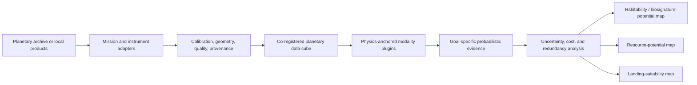

# Terra-Prospect

**Sensor-agnostic planetary flyover analysis for habitability, resources, and landing suitability.**

Terra-Prospect is a proof-of-concept research project for analyzing flyovers of planetary bodies
using whatever calibrated remote-sensing observations a spacecraft provides. A run may contain one
infrared product, hyperspectral imagery alone, radar and hyperspectral observations together, or a
larger multimodal collection.

The pipeline evaluates the available evidence independently for three goals:

1. **Habitability and biosignature potential** — environments that could support or preserve life,
   and observations relevant to candidate biosignatures. Remote imagery alone is not proof of life.
2. **Resource potential** — candidate water, volatiles, minerals, energy resources, or other useful
   materials, with uncertainty and accessibility assumptions made explicit.
3. **Landing suitability** — terrain and operational evidence relevant to a declared vehicle,
   including slope, roughness, thermal conditions, illumination, and data quality.

This repository is the public, non-sensitive project summary. Implementation, detailed research,
datasets, calibration parameters, model artifacts, and deployment configurations are maintained in
a private engineering repository.

## The problem

Planetary missions do not all carry the same instruments. Sensors also differ in resolution,
geometry, physical sensitivity, calibration maturity, coverage, and systematic error. Simply
stacking every image can increase confidence without adding independent information.

Terra-Prospect instead asks:

- Which goal can each available observation inform?
- Which sensor or combination adds the most useful, non-redundant evidence?
- Where is the evidence valid, missing, contradictory, or outside a model's applicability?
- How should uncertainty and provenance follow every derived map?
- Is the available evidence sufficient to support a decision, or should the system abstain?

## High-level approach

The design supports common modalities such as hyperspectral and multispectral imagery, infrared and
thermal observations, synthetic-aperture radar, altimetry, topography, and lidar. The payload is not
fixed: unsupported or missing modalities are normal, and a scientifically bounded plugin must
abstain when its required metadata or validity conditions are absent.

See [Flyover Concept](docs/flyover-concept.md) for the public architecture boundary.

## Combination analysis

Each modality contributes goal-specific evidence with a validity mask, uncertainty, quality,
processing cost, feature provenance, and declared shared systematics. Candidate combinations are
compared independently for each goal. More sensors are not automatically better: redundant,
low-quality, expensive, or invalid inputs can be excluded.

The current private proof of concept implements a transparent combination-selection contract and a
synthetic demonstration. Its scoring model establishes software behavior; it is not yet evidence of
scientific detection performance.

## Validation philosophy

Credible evaluation requires more than checking whether a model agrees with its own simulator.
Validation therefore emphasizes withheld scenes, instrument-removal ablations, uncertainty
calibration, missing and corrupted metadata, resolution changes, conflicting sensors,
cross-instrument transfer, and cross-body transfer.

Every result must remain traceable to its source observations, calibration and geometry, plugin and
model versions, validity envelope, and uncertainty assumptions. See
[Validation Principles](docs/validation-principles.md).

## Project status

The private engineering repository contains the initial sensor-agnostic scene and probabilistic
evidence contracts, goal-aware combination analyzer, synthetic demonstration, and regression tests.
The next external milestone is a small, remotely windowed real planetary archive example with one
scientifically bounded modality path per goal—without requiring a bulk dataset download.

Terra-Prospect remains a research proof of concept. It is not a life-detection claim, mineral
reserve estimate, certified landing-site product, or flight-qualified system.

## Earlier rover research

The project began as an autonomous Moon/Mars rover prospecting system with Bayesian belief maps,
active sensing, mobility-risk modeling, and drill-in-the-loop calibration. That work remains useful
as historical validation and as a possible downstream consumer of flyover products, but it is no
longer the primary product definition.

## Public/private boundary

This public repository may contain:

- general architecture, terminology, and scientific limitations;
- disclosure-safe diagrams, milestones, and validation principles;
- high-level results suitable for public release.

It does not contain:

- proprietary implementation source code or model weights;
- private datasets or unpublished research notes;
- mission-specific calibration values, thresholds, or deployment configurations;
- credentials, commercial IP, or sensitive partner information.

## Roadmap and collaboration

See the [Public Roadmap](docs/public-roadmap.md) for the disclosure-safe development sequence.

- **Star** the repository to follow the research.
- **Watch** repository activity for public milestones.
- Use **GitHub Issues** or **Discussions** for related work, scientific critiques, and collaboration
  ideas that do not expose restricted information.

## Repository policy

This repository is published for technical portfolio and project-discovery purposes. No license is
granted for commercial use, redistribution, or creation of derivative implementations.
